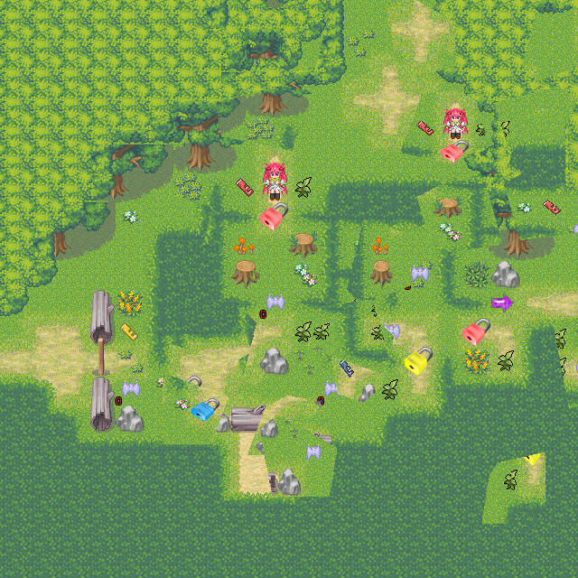

# 0.59 整合自查与验收

2026-10-20：约定范围的迁移整合已实现并通过内部自查，等待用户人工验收。当前工程：`../../output/0.59/release/黎之闪翼（开发中）_Godot/project.godot`。

- 172个维护脚本去掉文件名Flash前缀：98个运行、2个迁移器、72个测试；生成的flash_skill_catalog.gd也改为skill_catalog.gd。Editor_前缀保留。Game_ActorState与标准ActorState按职责区分；内部保存字段、原Ruby类与来源标识保持。
- 98个旧运行文件名保留ScriptPaths导航别名，无重复兼容脚本；旧名到新名清单随工程提供。直接preload使用当前路径。
- 默认碎屏新增480×480、36区域的程序生成灰度图及来源/SHA记录；已有原素材优先，自定义缺图仍拒绝。原480像素范围、160像素裁切与90帧规则保持。
- 0.58原代码在隔离环境写档，再由0.59读取，验证完整对象图、共享/循环引用、活动消息、跟随、演出、跨启动设置和撤回；分页现场另测。旧定义指纹保持。

| 正式自查 | 结果 |
| --- | --- |
| 从原RM全新迁移 | 成功，无导出错误；145原生事件、38份升级字节证据完整；运行/编辑器与维护代码逐文件一致 |
| 运行回归 | 文件名整合先通过63组；最终技能生成路径改名后14组针对性复验通过，含197脚本编译、310项新整合检查、原生事件正文、标题/菜单/档案、Message、普通战斗、钥匙门/拾取、持久化与撤回 |
| 编辑器 | 5组通过；实际EditorPlugin另通过13项代码高亮、事件正文编辑、保存和重开检查 |
| 错误边界 | 8个原生故意错误及26个服务拒绝进程通过；检查首错、来源、已发生写入及退出码1；编辑器故意编译失败属于预期诊断 |
| 图形及输入 | 9组实际GPU：合计831项、80画面；另有真实读档、主档损坏转备份、回标题流程；证据图片共83张 |
| 跨进程 | 本版保存/读取3+6项，0.58旧档读取6项、旧分页消息读取4项通过；所有测试使用隔离目录 |
| 持续运行 | 实际GPU运行318.4秒，11轮，54项通过；行走、实际菜单输入、原战斗/门、BackSpace撤回、显式存读档和资源监测 |
| 文档与审计 | 454维护脚本中文接口头，1,614项接口检查；266生产脚本/1,640公开方法。339来源、32职责组，未登记来源和未索引原资源均为零 |

持续运行交互帧中位数65.89毫秒、P95 78.92毫秒、最大91.69毫秒；显式存读档/撤回耗时见同名JSON各轮stages。该五分钟检查不等于完整剧情通关或全部地图长期稳定60FPS。冷启动和读档动态提示测量保留在GPU报告；首次资源准备仍有等待及帧峰值。

自查使用Godot4.7.2 Compatibility和实际GPU，Dummy音频驱动验证播放器状态；测试进程可关闭VSync，正式配置不变。原数值公式和首错退出保持。首次新增测试误用了PackedByteArray接口，已修正并重跑；旧审计探针的版本常量已改为读取真实RuntimeVersion；原生迁移断言登记了技能脚本路径别名，仍检查升级前后精确字节。编辑器创作测试会实际保存测试地图，跨版本与重启阶段已从正式工程重置隔离定义后再测。根证书、无界面纹理及受限环境的编辑器缩略图缓存写入诊断如实保留，正常最终场景无未预期GDScript错误。

新分辨率UI位置、完整剧情与原半成品系统继续留给游戏项目开发。特殊BOSS、RM原生回合制战斗、RTP及读取RM旧存档仍排除。完成声明仅针对闪翼约定范围，不能推断为任意RM脚本的通用自动兼容。实现及后续开发见[0.59说明](../migration_docs/INTEGRATION_v0.59.md)。

