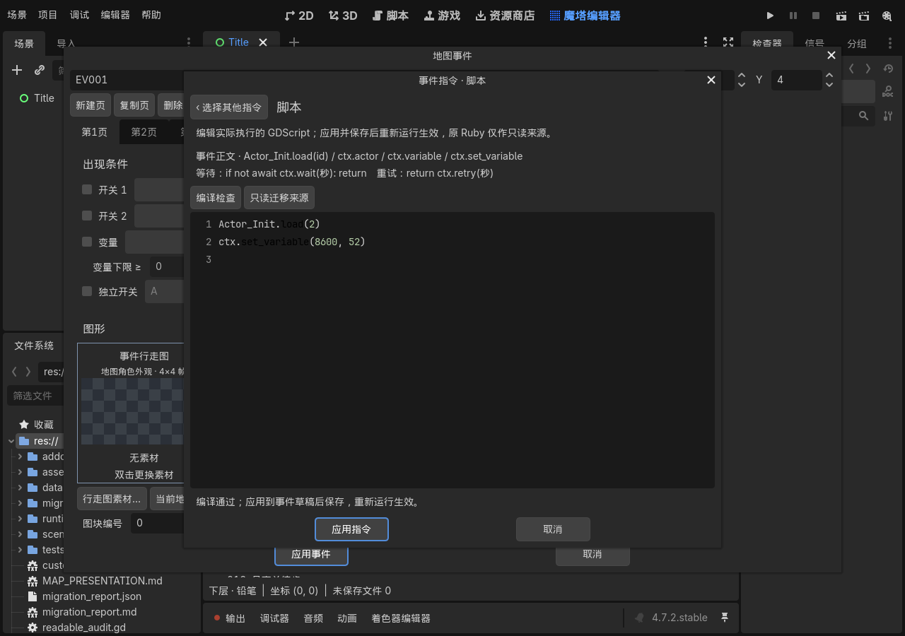

# 0.52 可读事件 GDScript 验证

2026-10-17 修正完成并通过自动验证，用户人工验收待进行。事件框保存实际 GDScript 业务正文；用户报告的初始化事件为 `Actor_Init.load(2)`。入口包装和来源管理移入框架，详细接口注释放在对应 `.gd` 模块。旧的用户自定义完整模块仍兼容。

正式工程：`../../output/0.52/readable-events/黎之闪翼（开发中）_Godot/project.godot`。从只读原 RM 重新迁移，36 张地图、4,097 个素材，迁移报告无错误。145 个入口全部是实际编译执行的业务正文，不通过单元编号执行隐藏的旧事件。

| 检查 | 结果 |
| --- | --- |
| 原工程迁移 | 145 个正文绑定、553 项检查；38 份升级前后精确字节证据匹配 |
| 正文行为 | 445 项通过：全部入口的正文及 SHA、直接编辑后执行、原生初始化与原程序完整角色快照逐项一致、大整数与屏幕等待结果 |
| 运行回归 | 10 组通过；179 个运行脚本编译，涵盖语义、绑定、等待、取消、公共调用、条件、路线、存档及撤回；普通战斗、开门、拾取 49 项通过 |
| 编辑器回归 | 3 组通过；51 个编辑器及附带转换器脚本、123 项指令块、18 项编辑保存与重开检查 |
| 独立错误进程 | 8 类通过：旧完整模块错误兼容及正文编译、运行、语义错误；实际正文行号正确，首错退出 1，已有修改不回滚 |
| 旧存档跨进程 | 0.51 写入 3 项、修正 0.52 读取 6 项通过；共享/循环数据、活动消息、效果、随从及撤回 |
| 实际 EditorPlugin 与 GPU | 10 项通过；简短正文、语法着色、行号、编译不执行、控件完整可见、应用、保存及重开 |
| 文档与接口 | 1,499 项通过；247 个生产脚本、1,563 个公开方法；414 个维护源码及 470 个交付脚本均有详细中文文件头 |
| 结构与排版 | 243 个生产脚本 AST/注释保持、目录索引、运行/编辑器边界及 SavePreparation 规范源一致 |

原工程升级后的定义指纹为 `6bd0e10f60f79b11a5f6206b465d82fa0f5342aaa3832f3786a8f163a7d80eb1`，与 0.51 相同。兼容只适用于自动升级前后精确匹配的文件；额外 JSON 字节改动会使兼容别名失效，原对象图、资源和生成方法校验继续执行。原 `Scripts.rxdata` SHA256 未变。

实际编辑器截图：

活动 await 协程及未被调度器接收的结果不能序列化，期间拒绝存档；可保存等待使用 `return ctx.retry(seconds)` 与 `ctx.fields`。取消、重开、换图或路线覆盖后旧异步上下文失效。

编辑器负例故意编译一次正文第 3 行错误，验证磁盘旧文件未改变；该条预期 Parse Error 单独统计。8 类首错进程的退出 1 是通过条件。本机全局编辑器缓存写入受限及证书日志另行区分，未作为脚本错误忽略。

完整剧情人工通关未进行；复杂原运算仍使用可复用语义兼容服务。图形 UI、Message、标题和菜单还原继续后续版本。原 0.52 完整生成模板已由本次可读性修正替代。

机器记录见 `VERIFICATION_v0.52.json`；日志为源码 `.godot/test-logs/v052-readable-release-*`、`v052-readable-final-plugin.*` 和 `v052-readable-documentation-final.log`。正式归档逐文件重读核对 SHA256 后，按用户要求只保留该版本最终 ZIP 及最新展开工程。
