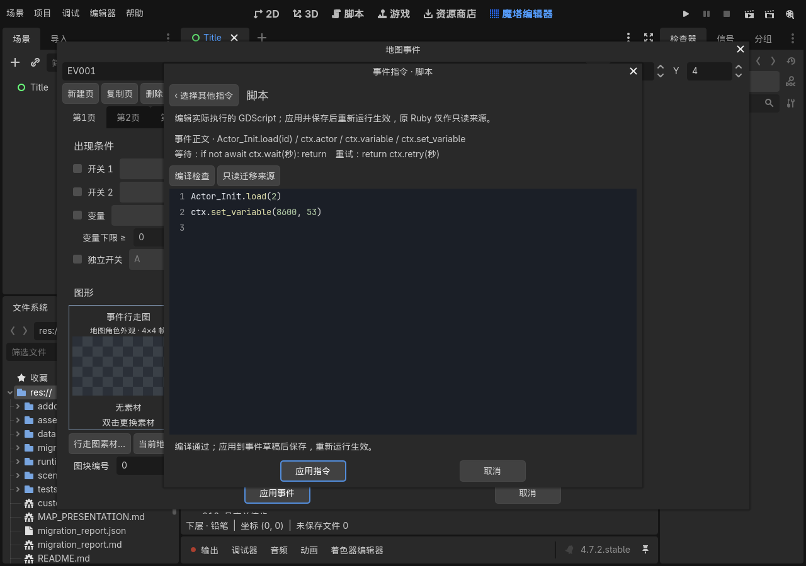
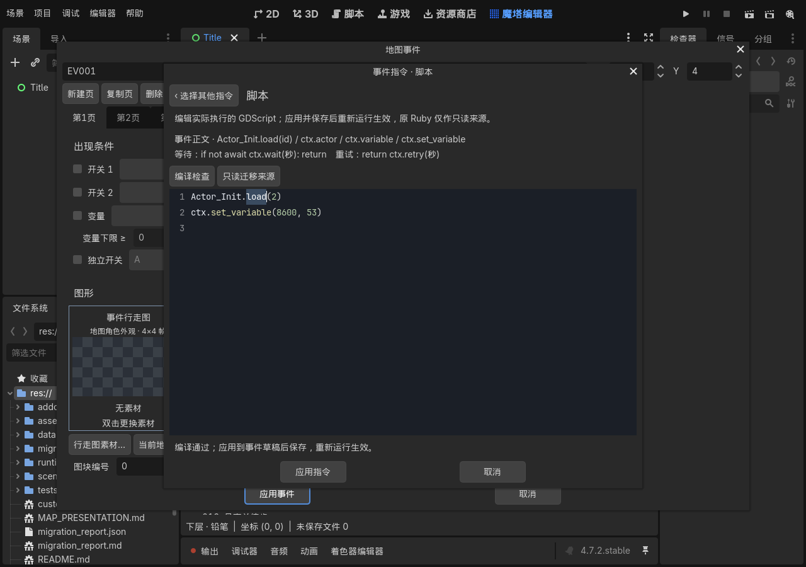
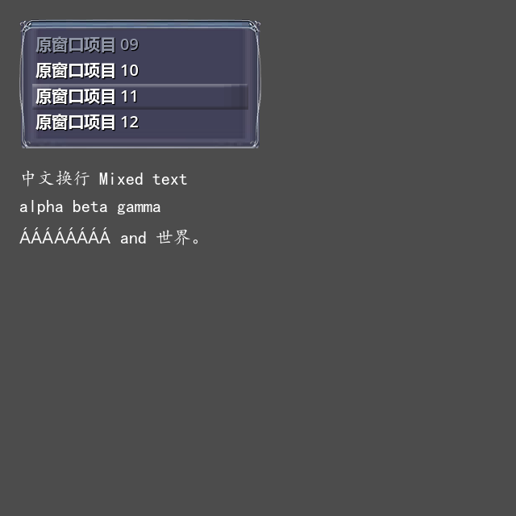

# 0.53 共用图形与文本基础验证

2026-10-17：实现及自动验证完成，用户人工验收待进行。正式工程为 `../../output/0.53/final/黎之闪翼（开发中）_Godot/project.godot`，从只读原RM全新迁移，36张地图、4,097个素材，迁移报告无错误。

| 检查 | 结果 |
| --- | --- |
| 正式原生事件来源 | 145个正文入口、553项检查，旧绑定与SHA失配为零，38份升级字节证据匹配 |
| 共用UI | 57项无界面检查、61项GPU检查通过；混排、组合音标、像素分页、末页、实际窗口文字滚动、resize、光标裁切、按键及过渡替换/取消 |
| 运行回归 | 16组通过，184个运行脚本编译；消息文字/控制器、标题/笔记、菜单、资源缓存、原生事件、存档、撤回及结构 |
| 原有事件与玩法 | 445项正文检查、26项上下文/等待/取消、49项普通战斗/开门/拾取通过 |
| 编辑器 | 4组通过；51个编辑器及附带转换器脚本、123项指令块、18项编辑保存、6项实际语法高亮对比度检查 |
| 实际EditorPlugin | 13项通过；方法名及选中状态清晰，正文编译不执行，保存重开一致，GPU截图已检查 |
| 实际场景渲染 | 标题、主菜单、文字首/末页及窗口滚动截图；原Message的对话、选项、提示与历史5种画面，以及菜单27项GPU检查通过 |
| 旧存档 | 原0.52独立进程写入3项、正式0.53读取6项通过；循环/共享对象、活动消息、效果、随从及撤回恢复 |
| 注释与接口 | 1,529项通过；252个生产脚本、1,581个公开方法，423个维护源码和478个交付脚本具有中文接口文件头 |
| 排版及边界 | 248个脚本AST/注释保持和最终排版检查通过；目录登记、运行/编辑器边界及SavePreparation一致 |

定义指纹仍为 `6bd0e10f60f79b11a5f6206b465d82fa0f5342aaa3832f3786a8f163a7d80eb1`。旧档兼容仍要求自动升级前后数据精确匹配；用户额外编辑会使别名失效。原RM的Scripts.rxdata SHA256未变，未执行Ruby或修改原公式。

验收入口：

1. 打开魔塔编辑器中的脚本，确认 `Actor_Init.load(2)` 的 `load` 和 `ctx.set_variable(...)` 的方法名可见；选中后文字同样可辨认。
2. 在标题和地图菜单检查文字、方向导航及确认/取消；这些页面本版仍保留现有布局，原图形恢复按后续版本推进。
3. 开发新的文字区域可使用UITextBlock的configure、page_count和set_page；长文本按实际宽高分页，窗口resize后重排。通用命令窗口选到下方时内容与光标一起滚动。

接口与范围见 `migration_docs/UI_FOUNDATION_v0.53.md`（源码中为 `docs/UI_FOUNDATION_v0.53.md`）。其它渲染证据为同目录v053-title/menu/message/scroll图片。

本轮修正两处过时测试假设：资源分类已包含Faces/Skills，独立数组检查改为核对分类快照；生成脚本数量由实际目录清单计算。旧档检查在干净数据上先运行，编辑器保存负例随后运行，避免测试改过的地图污染兼容判断。编辑器负例的一条预期Parse Error单独统计，磁盘旧数据保持验证继续执行。

本机Godot全局缩略图/设置缓存写入受限及证书日志与脚本错误分别核对。完整剧情人工通关未进行；Message完整气泡交互、标题及菜单原图恢复继续0.54—0.57，Flash前缀仍待收尾统一处理。静态文字切页不推进事件，活动await存档限制沿用0.52。

机器记录为VERIFICATION_v0.53.json；源码日志位于`.godot/test-logs/v053-release-*`、`v053-gpu-core-final.log`、`v053-gpu-scenes.json`、`v053-ui-plugin.json`与`v053-documentation.log`。归档逐文件重读核对后，清理已归档旧展开目录及可重建测试副本。
