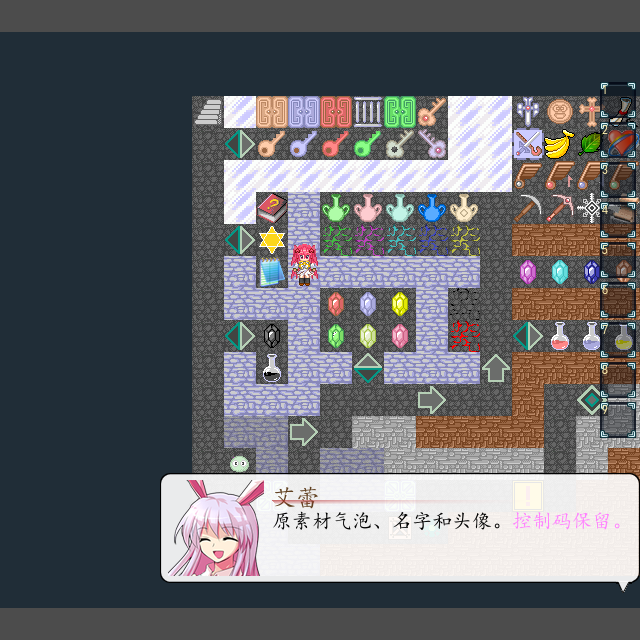
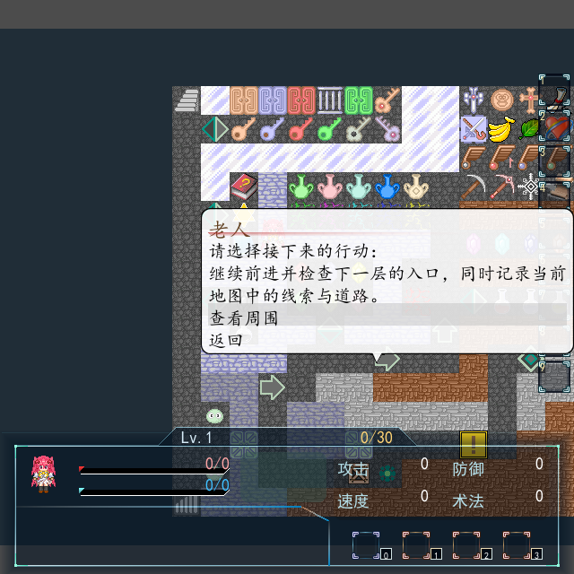
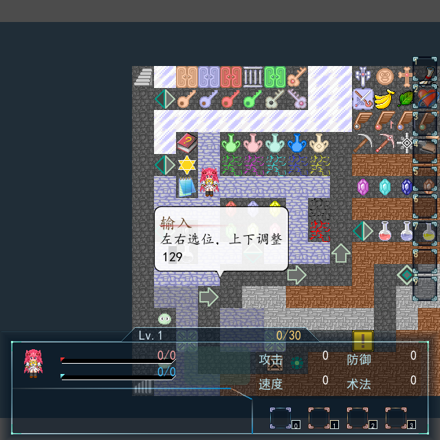
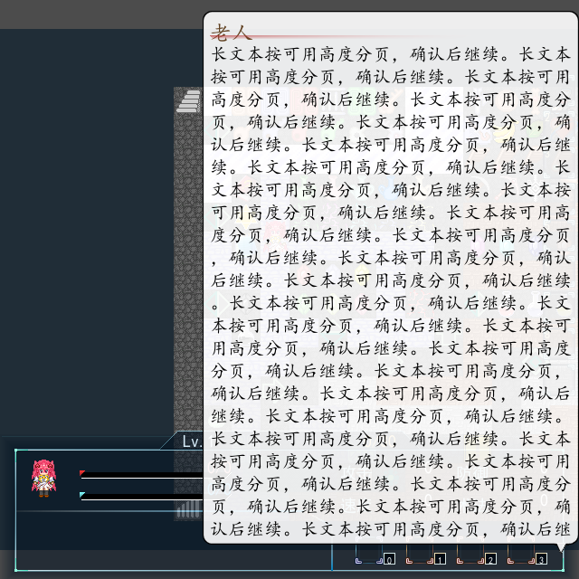
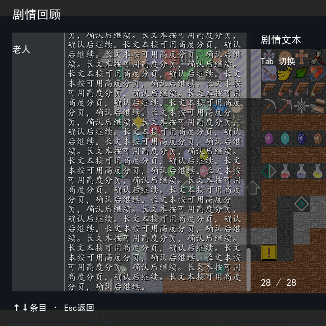

# 0.54 Message 对话气泡内部验证

2026-10-17：实现和内部验证完成。用户明确要求将人工验收放在后续版本，本版不标记用户已验收。正式工程为 `../../output/0.54/release/黎之闪翼（开发中）_Godot/project.godot`，从原RM全新迁移，36张地图、4,097个素材，迁移报告无错误。

| 检查 | 结果 |
| --- | --- |
| Message专项 | 52项无界面、63项真实GPU检查通过；原素材边框/箭头、头像名字、人物锚点、屏幕边缘、状态栏切换、长文分页与resize、多行选项、数字光标、取消和历史 |
| 实际事件链 | Map003 EV022连续原文章、117调用公共事件19版权说明通过；确认关闭后继续，后续变量变更只执行一次 |
| 分页存档 | 独立进程写2项、读4项通过；在真实解释器的待翻页处保存，重开恢复同一请求与页，前后事件变更各执行一次 |
| 0.53旧档 | 原0.53运行代码写入3项、正式0.54读取6项通过；活动对话、共享/循环对象、效果、随从及撤回恢复 |
| 运行回归 | 18组通过，184个运行脚本编译；文字24、气泡状态18、消息控制器31、表现现场34、持久化25，及原生事件、普通战斗/开门/拾取、菜单、缓存与结构 |
| 编辑器 | 4组通过，51个脚本编译、123项指令块、18项原生正文编辑保存及6项高亮检查；保存负例的一条预期Parse Error单列核对 |
| 正式迁移来源 | 145个原生正文入口，无旧绑定及SHA失配；38份原生升级前后精确字节证据匹配 |
| 注释与接口 | 1,529项通过，252个生产脚本、1,584个公开方法；426个维护源码和480个交付脚本有中文接口文件头 |
| 排版和边界 | 248个脚本AST/注释保持，最终格式无变化；路径登记、运行/编辑器依赖边界、SavePreparation及git diff检查通过 |

定义指纹仍为 `6bd0e10f60f79b11a5f6206b465d82fa0f5342aaa3832f3786a8f163a7d80eb1`，原Scripts.rxdata SHA256未变。正式依据是rxdata加载顺序及既有修正，W/T/ML/MU保持40帧编写参数到60Hz运行的换算，没有以另一份Scripts镜像覆盖。

历史打开时隐藏并暂停活动气泡，关闭后继续同一现场。颜色、字体和图标仅用于历史绘制，不重新播放控制码声音、不执行奖励。新增可选message_ui存档字段在安装前验证；旧0.53记录沿用缺省值，旧定义兼容仍要求数据精确匹配，用户额外修改不放宽校验。

后续集中验收可检查：地图中触发对话，确认名字/头像/箭头和边缘位置；长文按确认翻页，选择项用上下，数字输入用左右选位/上下调整；按L打开历史、Tab切换频道、Esc返回后继续对话。开发接口见源码 `docs/MESSAGE_v0.54.md`，生成工程为 `migration_docs/MESSAGE_v0.54.md`。

其它画面为同目录v054-hint.png。GPU使用Compatibility/NVIDIA GTX1660Ti，实际Viewport按键已走覆盖层。无法取得原RM运行截图，图形比较依据为正式源码与原素材；完整剧情人工通关未进行。单个字号/图标超过整个文字区域仍裁切，标题及菜单原图继续0.55—0.57，Flash前缀按收尾要求暂留。

首份final候选之后补齐状态栏切换重排，因此另从原RM迁移release，未将候选覆盖后冒称正式导出。正式release与最终维护模板逐文件一致。旧档测试先于会实际保存Map001的编辑器测试，避免测试修改污染兼容判断。证书/受限全局Godot缓存日志与脚本错误分别核对。

日志为源码`.godot/test-logs/v054-release-*`、`v054-gpu.json`、`v054-page-restart.json`及`v054-documentation.log`；机器记录为同目录VERIFICATION_v0.54.json。归档逐文件重读后再清理旧展开目录、候选及可重建副本。
