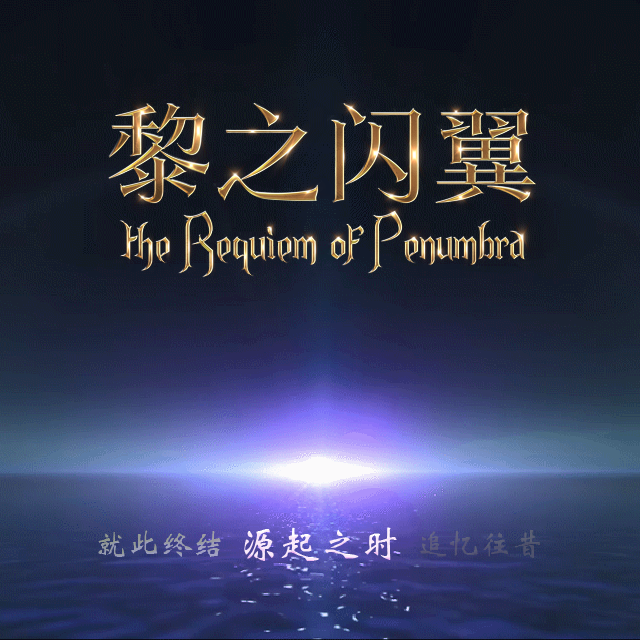
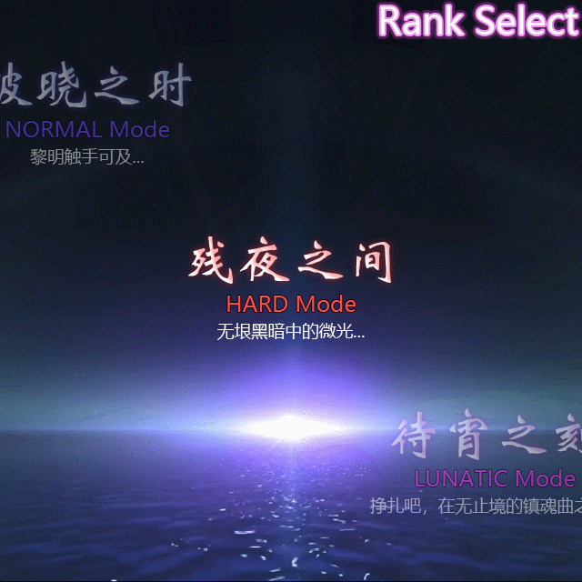
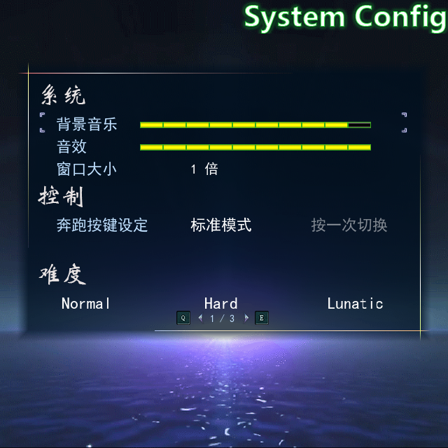
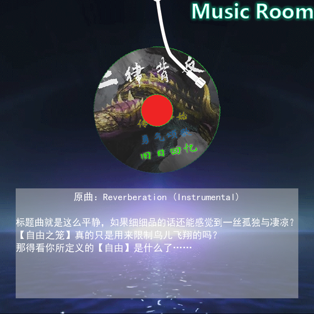
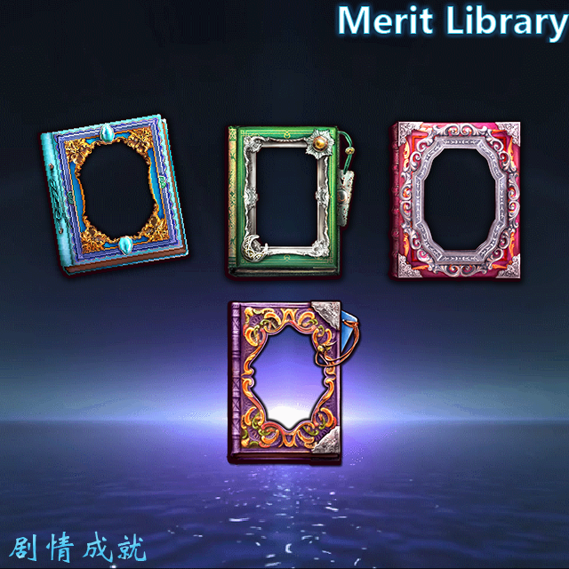
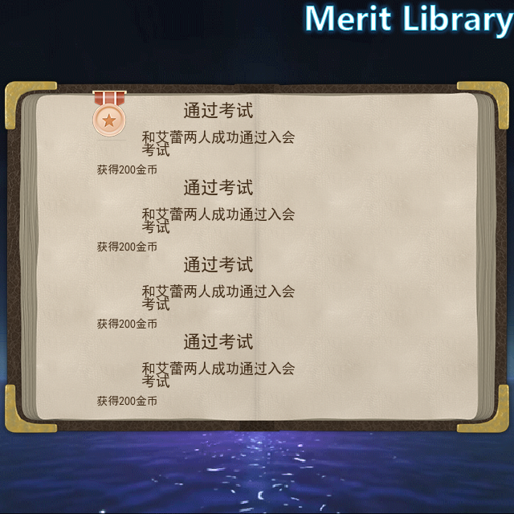

# 0.55 标题原图恢复内部验证

2026-10-18：实现和内部验证完成；人工验收按用户要求集中在后续版本，本版不标记用户已验收。正式工程：`../../output/0.55/final/黎之闪翼（开发中）_Godot/project.godot`，从原RM全新迁移，36张地图、4,097个素材，迁移报告无错误。正式输出与当前运行/编辑器模板逐文件一致；验证在其可重建副本运行。

| 检查 | 结果 |
| --- | --- |
| 标题专项 | 59项无界面、74项GPU，14个真实画面；原图、轮播中间状态、难度、设置三页、唱片、成就书、继续、返回、resize、480帧循环与缓存上限 |
| 实际键盘流程 | 六个独立进程通过：四难度新游戏、继续游戏、退出；实际进入Game场景、保持准确难度/存档现场，确认不重复提交 |
| 0.54旧档 | 原0.54代码写入3项，正式0.55读取6项：活动消息、共享/循环对象、效果、随从和撤回 |
| 分页存档 | 保留0.54专项的跨进程写2项/读4项，恢复同一消息页且事件副作用不重复 |
| 运行回归 | 20组通过；185个运行脚本编译，Message、菜单、设置、原生事件、普通战斗/开门/拾取、持久化、缓存和目录边界 |
| 编辑器 | 4组通过：51脚本编译、123指令块、18原生正文保存及6配色；保存负例的一条预期Parse Error单列核对 |
| 正式来源 | 145个原生正文入口，无旧绑定或SHA失配；38份精确升级证据；原Scripts.rxdata未修改 |
| 接口与排版 | 1,535项接口核对，253个生产脚本/1,591个公开方法；429个维护与482个交付脚本有中文说明；249个生产脚本排版无差异 |

GPU使用Compatibility/NVIDIA GTX1660Ti，真实Viewport输入。正式标题连续180帧的间隔：中位数16.666ms，P95 16.834ms，最大17.339ms；这是当前机器的短时样本，不代表完整剧情或所有环境性能。背景缓存≤32、并发请求≤8；正式循环有真实纹理切换。

定义指纹保持`6bd0e10f60f79b11a5f6206b465d82fa0f5342aaa3832f3786a8f163a7d80eb1`；旧存档兼容规则没有放宽。旧档读取先于会保存Map001的编辑器测试。四份标题接口说明在导出后补充参数与信号说明，逐文件证明仅文件头改变、执行正文完全一致；正式GPU和六个流程使用同步后的文件。菜单导航旧测试读取已取消的按钮容器，已改为验证原图复用、灰显可选和16帧门控，单独重跑通过，保留原失败日志。只读原RM、源码和独立未标版本用户工程保留；最终ZIP逐文件重读校验后清理旧展开和可重建副本。

比较依据是正式Scripts.rxdata的最终0139—0145、0111有效源码与原素材；没有原RGSS运行截图作逐像素对照。音乐get_new_bitmap原本为空，不切曲或伪造试听；成就书仅原示例，无发奖与解锁实现。示例文字沿用可读显示并下移24px进入纸面，原draw_text宽度采用水平适配，避免尾字裁切。设置后两页保留原未完内容。档案完整图形恢复在0.56，菜单/功能页按0.56—0.57；Flash前缀暂留。

集中人工验收时，可用方向键浏览七命令，Enter/Z/空格确认，Esc/X返回。新游戏选择四难度；设置Q/E切页；音乐上下切唱片；成就确认开书、取消退回分类再回标题。新游戏和继续读取仍操作正式RuntimeState。实现与接口见`docs/TITLE_v0.55.md`，生成工程见`migration_docs/TITLE_v0.55.md`。

其余状态截图均为同目录v055-*.png。日志见源码`.godot/test-logs/v055-release-*`、`v055-gpu.json`、`v055-flow.json`和`v055-documentation.log`；机器记录为同目录VERIFICATION_v0.55.json。证书和受限Godot编辑器配置写入日志不作为脚本失败；无界面纹理驱动的空纹理诊断与真实GPU分开核对。
