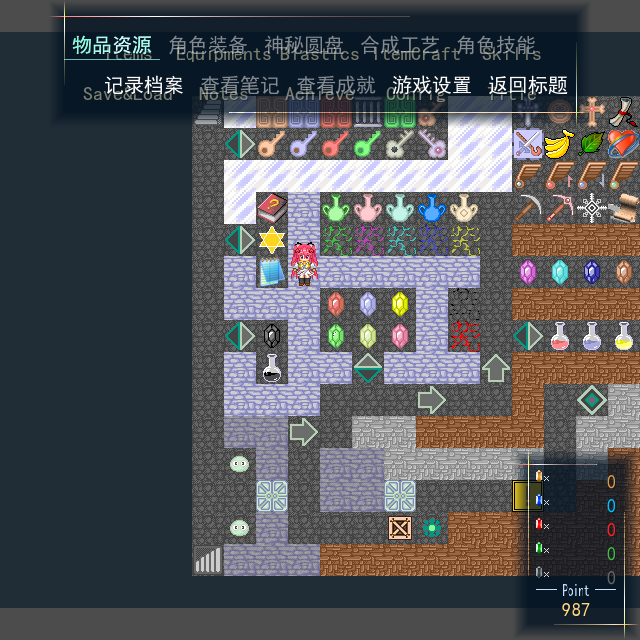
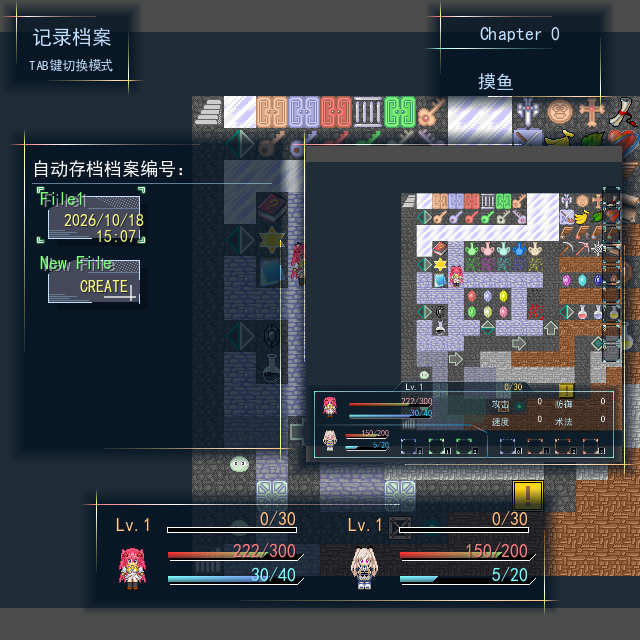
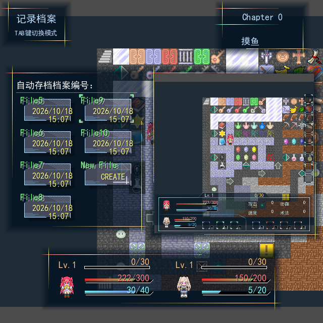
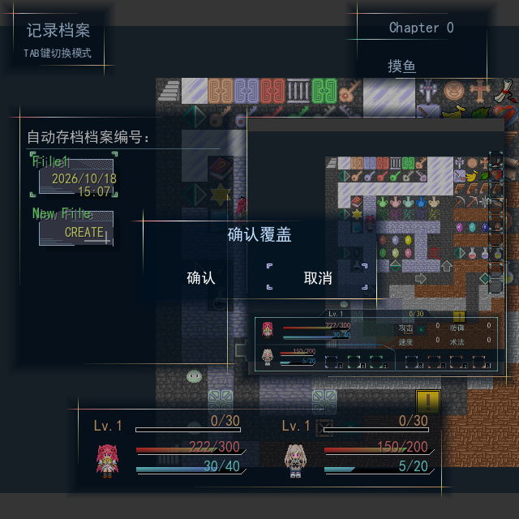
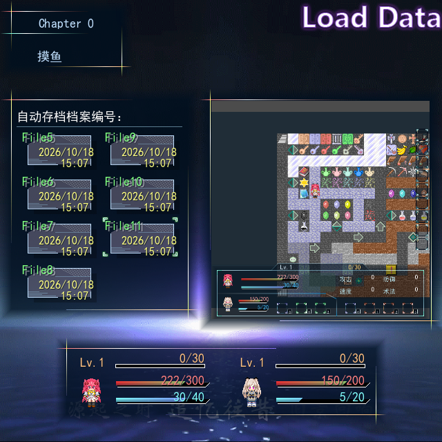

# 0.56 主菜单与档案内部验证

2026-10-18：实现和内部验证完成。用户明确标题、菜单、档案UI之后统一人工验收，本版不标为用户已验收。正式工程`../../output/0.56/delivery/黎之闪翼（开发中）_Godot/project.godot`从原RM重新迁移，36张地图、4,097个素材，迁移无错误；运行/编辑器模板逐文件一致，无导出后执行代码覆盖。final和release分别在补齐低帧率关闭保护及标题档案8帧时序前生成，仅作候选；交付delivery从原RM重新迁移。

| 检查 | 结果 |
| --- | --- |
| 菜单档案专项 | 57项无界面、73项GPU；原错位文字/锁定/光标/货币、四向多窗进退、真实卡片/章节/人物/截图、滚动/选择、覆盖与失败反馈 |
| 标题共用档案 | 保留74项GPU检查及14画面；菜单档案另15画面，共29画面/147项；标题原章节左侧位置、档案及页签8帧和独立16帧命令退场正确 |
| 实际键盘流程 | 九个独立进程通过：四难度新游戏、标题继续/退出、地图读档、损坏主档的备份确认恢复、返回标题 |
| 实际保存与事件 | 菜单确认只写一次，保留打开前完整地图截图与所选角色摘要；351菜单、352取消及352成功保存均在8帧退场后继续原调用者一次，原事件保存许可有效 |
| 0.55旧档 | 原0.55代码写3项、正式0.56读6项：活动消息、共享/循环图、效果、随从及撤回；消息分页跨进程写2/读4项通过 |
| 运行回归 | 22组全部通过；187个运行脚本编译，包含设置、档案、菜单、Message、原生事件、普通战斗/开门/拾取、持久化与缓存 |
| 编辑器 | 4组通过：51脚本编译、123项指令块、18项原生正文编辑保存、6项配色；负例的一条预期Parse Error单列核对 |
| 来源与兼容 | 145个原生正文入口、0旧绑定/失配；38份精确升级证据；定义指纹保持`6bd0e10f60f79b11a5f6206b465d82fa0f5342aaa3832f3786a8f163a7d80eb1`，原Scripts.rxdata SHA未变 |
| 接口与结构 | 1,547项接口核对，255个生产脚本/1,606个公开方法；433个维护和485个交付脚本均有中文说明；251脚本格式无差异，AST与注释保持 |

实际键盘来自Viewport，正常导航不重读存档或重建页面，预览缓存最多8张。跨列只在原240×256区域滚动，四角光标与预览各按8帧推进；父入场不重复推进。成功保存只有一次确认音，读档失败恢复两层提交保护，不安装损坏数据。备份读取默认取消、明确确认后完整恢复。

GPU为Compatibility/NVIDIA GTX1660Ti。离屏窗口默认垂直同步时观测到约250ms等待；同一标题短探针对照关闭同步后中位数回到约16.7ms。图形与短时测量因此在测试命令加`--disable-vsync`，正式工程的同步设置没有修改，也不据此宣称所有环境稳定60帧。正式菜单120帧中位数16.666ms、P95 16.892ms、最大17.419ms；标题180帧中位数16.666ms、最大17.165ms。该菜单样本由真实页面时钟推进、地图仍暂停。

核对正式有效0111、0139、0170—0173、0181、0186、0197—0198、0200—0203及原素材。最终菜单没有开启截图模糊，HUD会收起；预览截图才保留打开前完整HUD构图。原Window_FileTips未实例化，旧移植额外Tips已移除，仅真实失败占用空白区。原章节0/1、空装备/成就/合成分支、未实现自动存档均保持，功能页完整图形在0.57。没有原RGSS运行截图逐像素对照或完整剧情人工通关。

后续统一验收：地图Esc开菜单，上下移动相邻项、左右换列、Enter/Z/空格确认、Esc/X返回；档案Tab切存/读，方向键移动卡片，覆盖和备份恢复先确认。标题继续共用这份档案页。人工验收仍待用户，接口见`docs/MENU_ARCHIVE_v0.56.md`，生成工程对应`migration_docs/MENU_ARCHIVE_v0.56.md`。

其余画面见同目录v056-*.png。机器记录为VERIFICATION_v0.56.json；日志在源码`.godot/test-logs/v056-release-*`、`v056-menu/title/flow/mapflow.json`和`v056-frame-probe.json`。预期损坏存档warning、无界面驱动纹理诊断及证书/受限编辑器设置日志，与实际脚本错误分别核对。低帧率下每次补算最多120逻辑帧，菜单和档案关闭请求均只发出一次；专项覆盖持有方暂留节点的后续帧。旧档读取先于会保存Map001的编辑器测试，正式输出本身未被编辑器探针改写。
