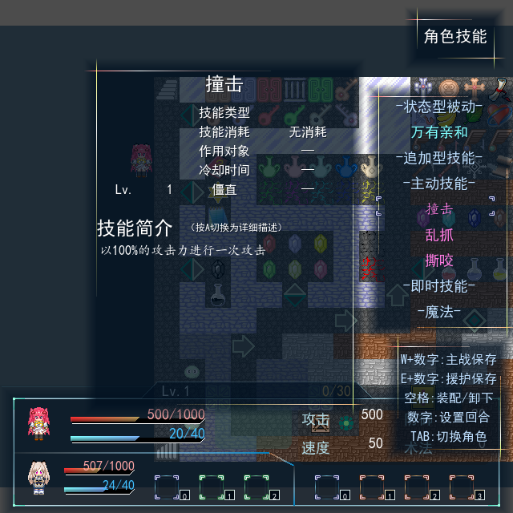
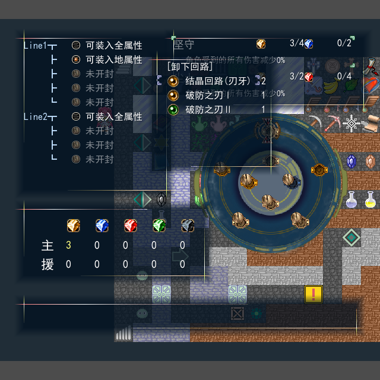
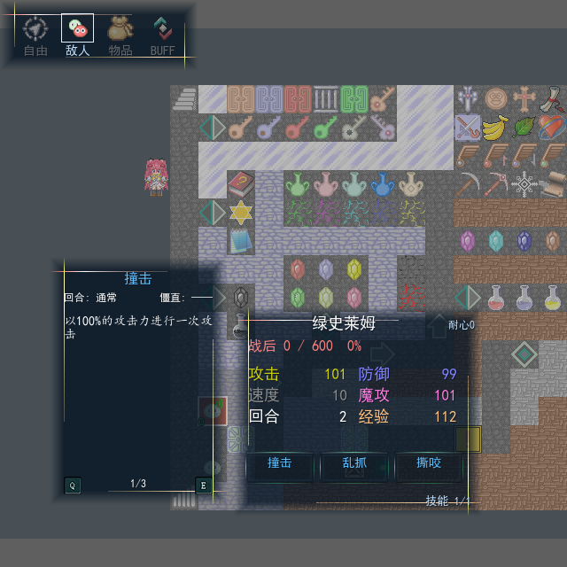
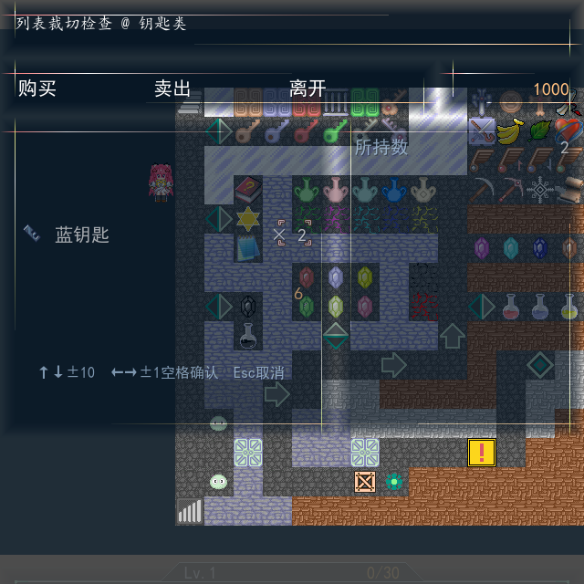

# 0.57 功能窗口内部验证

2026-10-18：实现与内部验证完成，正式工程为`../../output/0.57/final/黎之闪翼（开发中）_Godot/project.godot`，从原RM重新迁移。36张地图、4,097个素材，迁移无错误。0.56已通过用户验收；新分辨率下部分窗口位置按用户安排留待后续统一UI调整，0.57人工验收另记。

| 检查 | 结果 |
| --- | --- |
| 功能页专项 | 86项无界面、110项GPU、22画面；真实Viewport输入，物品/九格预设/Q置空/恢复目标、技能回合/Tab角色及退出恢复、回路预览/确认保持候选、锁定笔记、灵视/行动图、地图、独立装备/楼层与商店 |
| 菜单档案回归 | 73项GPU、15画面；合计37画面/183项图形检查。三条独立冷进程流程通过：真实读档、损坏主档备份确认恢复、返回标题 |
| 状态与焦点 | 预览不修改背包/圆盘，确认只执行一次原业务；同一地图及角色对象保持。方向键遵守原八帧光标；区域单独裁切，重复刷新复用节点；640/768宽度实际显示与白字可读性通过 |
| 灵视 | 原图集、带色相人物、参数与战前/战后HP、技能卡、详情与行动顺序；真实敌人多技能快照验证208帧轮播、16帧文字淡入退及Q/E；BUFF空钩子保留 |
| 运行回归 | 28组通过，195个运行脚本编译；包含Message、标题、设置、档案、物品、灵视、地图、独立页、商店业务、原生事件、战斗/开门/拾取和持久化 |
| 编辑器回归 | 4组通过：51脚本编译、123项指令块、18项原生正文编辑保存、6项配色；负例的一条预期Parse Error单独核对 |
| 旧档与消息现场 | 原0.56代码写3项、正式0.57读6项；共享/循环关系、消息、随从、效果及撤回保持；分页跨进程写2/读4项通过。读取在会保存Map001的编辑器测试之前 |
| 事件与来源 | 145个真实原生正文、0旧绑定/失配、38份精确字节证据；51份有效UI来源SHA与正式交付一致；原Scripts.rxdata未改 |
| 接口和结构 | 1,595项接口核对，263个生产脚本/1,625个公开方法；443个维护及494个交付脚本有详细中文接口头，259脚本格式无差异；运行/编辑器模板逐文件一致 |

定义指纹保持`6bd0e10f60f79b11a5f6206b465d82fa0f5342aaa3832f3786a8f163a7d80eb1`。运行与编辑器代码没有导出后覆盖；仅把旧结晶确认后返回槽位的测试断言同步为最终0202保留候选焦点，并针对性复测，交付测试与维护测试一致。旧通用ShopStateTests使用原生RM固定库测试数据，在旧0.56与新0.57闪翼工程下均于同一“此商品不在当前商店中”首错退出；不将其当作闪翼验收。真实闪翼商店25项业务和本版实际键盘购买/出售/数量流程已覆盖，边界记录为JSON的test_scope。

图形运行于Compatibility/NVIDIA GTX1660Ti，测试命令使用`--disable-vsync`避免既有离屏窗口同步等待；正式工程同步配置保持。未以这些短时检查宣称所有场景稳定60帧。图形核对依据为正式生效来源与原素材，没有原RGSS运行截图作逐像素比较；滚动类别与固定7HP/4SP恢复场景是明示的内存测试设置，不改正式数据库或原恢复算法。

装备主菜单空分支、成就/合成、魔法、BUFF、空BlasticTitle与回响“减少0%”按原边界保留。独立装备继续使用既有六槽接口，原0258旧五槽代码不冒充完整现代装备界面。地图系统既有自绘与0248一致，重新核对画布、发现状态、预览缓存和输入。Flash前缀按既定收尾要求暂留，完整剧情人工通关不在本轮记录中。实现与接口见[功能窗口说明](../docs/FUNCTION_WINDOWS_v0.57.md)。

其它画面在同目录v057-*.png；机器记录为VERIFICATION_v0.57.json，日志见源码`.godot/test-logs/v057-release-*`和`v057-functional/menu/mapflow.json`。证书存储诊断、无界面驱动纹理诊断、预期损坏存档与编辑器负例分别记录，GPU无脚本错误。
