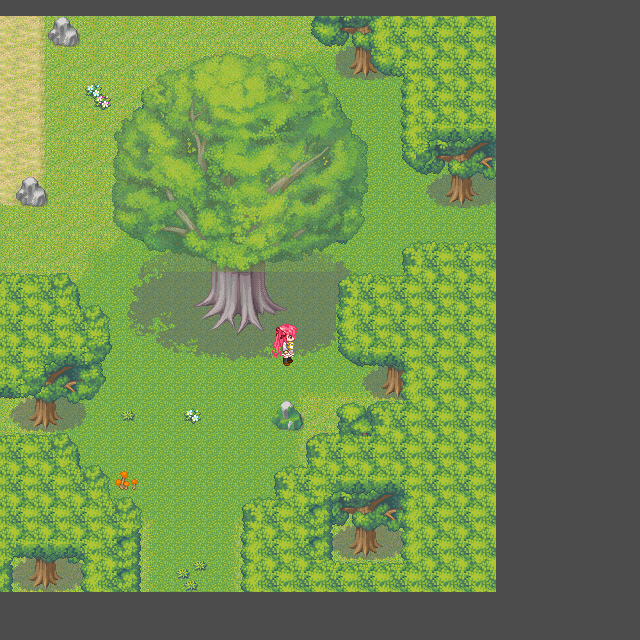
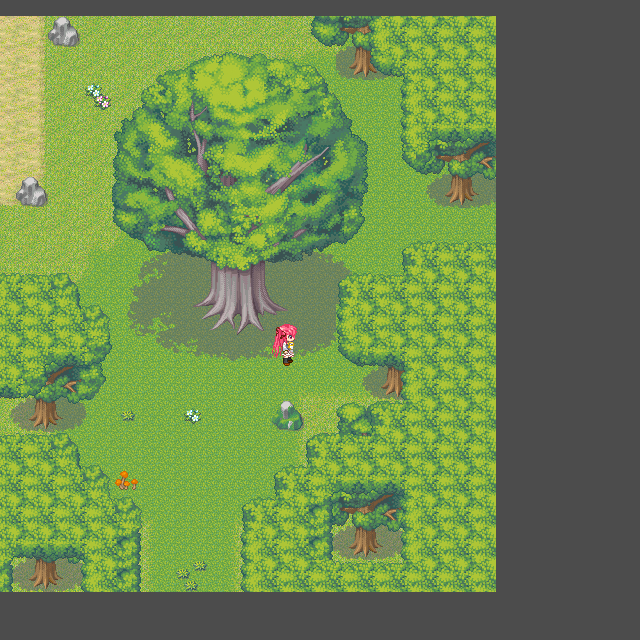
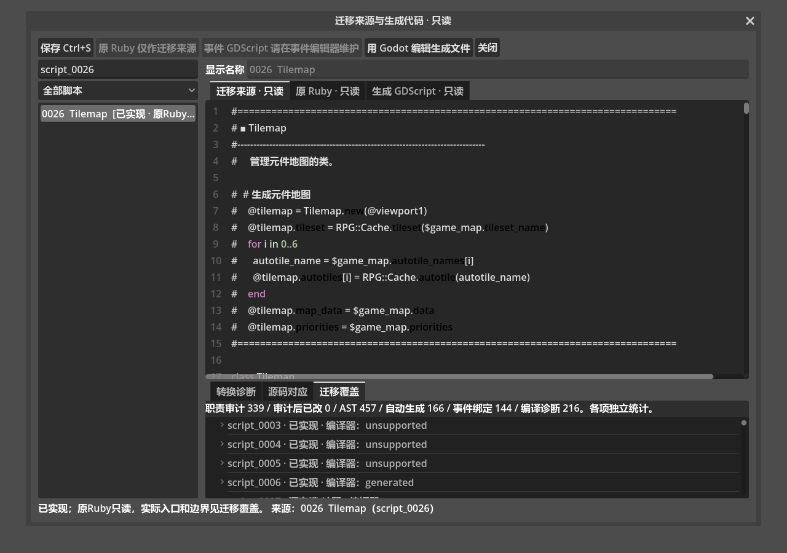
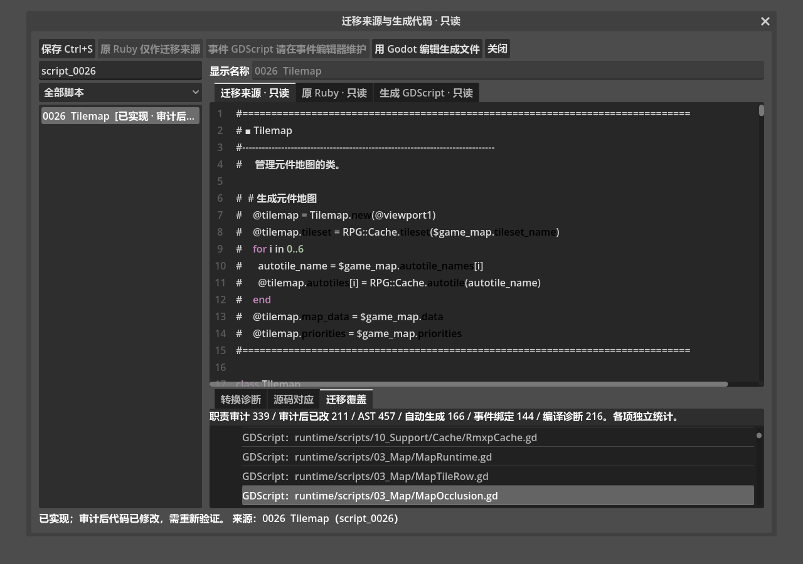

# 0.58 内部自查与人工验收入口

2026-10-19：当前交付已更新到`../../output/0.58/load-release/`，新增读档、BGM和共用物品栏验证见[本轮记录](VERIFICATION_v0.58_LOAD.md)。本页保留历史检查事实。

2026-10-19 UI修正已另交付，当前工程改为`../../output/0.58/ui-review/`；本页为此前完整自查历史，新增F7及物品栏修正见[本轮验证](VERIFICATION_v0.58_UI.md)。

2026-10-19：0.58实现与内部自查完成，等待用户人工验收。正式工程：`../../output/0.58/final/黎之闪翼（开发中）_Godot/project.godot`。0.56已由用户验收；0.57只记录内部验证。新分辨率窗口位置继续按用户安排后续统一调整，Flash前缀本版暂留。

| 自查 | 结果 |
| --- | --- |
| 来源与入口 | 339原脚本槽、32职责组、2,790条方法/alias/模块暴露、565字段声明、21条覆盖链、130动态候选；732字面运行依赖、4,077索引资源路径及56处原源完整字面资源引用已核对，未登记来源及原存在却漏索引的资源均为0 |
| 分类边界 | 204来源由Godot职责实现、7处原未完成、93空槽/注释、35用户排除。503声明为显式词法候选，不能当作完整Ruby语义解析或逐方法自动转换证明 |
| 遮挡补迁 | 原0026四向上层连通区160/255透明度；地面/新增高层保持不透明，原地和同区缓存复用，改图和重载恢复。真实Map022以及明示的内存调色图均有GPU证据，数据/优先级未改 |
| 运行回归 | 60组通过；196运行脚本编译，覆盖原生事件、原公式/普通战斗、开门/拾取/巨钥匙、物品、成长、灵视、地图、跟随、消息/历史、标题、功能窗口、配置、存档与撤回 |
| 错误边界 | 8个原生GDScript故意错误进程与26个原有限服务拒绝进程通过；核对首错、已发生写入、来源与退出码1，不把预期错误当作正常失败 |
| 实际图形 | 413项GPU检查、65画面：遮挡6、功能页22、菜单档案15、标题14、Message6、编辑器2。真实Viewport输入与独立冷进程读档/备份确认/回标题通过 |
| 编辑器 | 5组通过：51脚本编译、123指令块、18原生正文保存、6配色与15审计检查；GPU17项包括“已实现”与编译器unsupported分离、原文只读、同名覆盖与实现改动失效提示 |
| 保存兼容 | 真正0.57运行代码写3项，正式0.58读6项；消息分页跨进程写2/读4项。读取发生在会保存Map001的编辑器探针之前，正式工程数据未被探针改写 |
| 来源正文 | 145真实原生GDScript正文，0旧绑定/失配，38份精确字节升级证据；原Scripts.rxdata未改，定义指纹保持`6bd0e10f60f79b11a5f6206b465d82fa0f5342aaa3832f3786a8f163a7d80eb1` |
| 注释与结构 | 1,608项接口检查、265生产脚本/1,631公开方法；449维护及498交付GDScript有中文接口头，261脚本格式/AST/注释核对通过。运行/编辑器模板与正式代码逐字节一致 |

自查修正了三组过时测试：巨钥匙尾部验证真实原生正文及SHA，原公共事件使用其当前GDScript正文和调用归属，菜单性能检查改为观察进场后的持久绘图节点。业务断言保持，原事件23项、旧CE36完整流程和持久化均已通过。初候选被新的字节核验拒绝，定位为版本声明替换丢失CR行尾；修正生成器并加入精确字节回归后，从原RM全新导出的正式工程通过。最终只刷新了来源分类/覆盖元数据（登记旧Scene_Menu引用不存在的独立场景），没有覆盖运行或编辑器代码。

旧0.47文档中的静电/冻结/Crash音效缺失记录已过时；本版按真实索引与大小写别名核对，静电/冻结实际导入及已有演出检查通过，仍缺原默认sptx碎屏蒙版。实际输入由既有有限服务承担，未知新Ruby eval/FFI/回调仍明确拒绝。

验收时可重点查看：在有树冠/屋檐的地图（如Map022）走入和离开遮挡区；进入脚本工作区的“迁移覆盖”，查看0026对应MapOcclusion及最终Window_Item/Window_Skill来源；再串联新游戏、对话/历史、菜单各页、普通战斗/开门、存读档和撤回。事件GDScript继续在事件编辑器维护。原空分支、半成品和既有排除见[完整审计](../docs/MIGRATION_AUDIT_v0.58.md)。

图形使用Compatibility/NVIDIA GTX1660Ti；仅测试加`--disable-vsync`避免既有离屏同步等待，正式同步配置保持。原源Map022真实画面与精确透明度内存夹具分别登记；没有原RGSS截图作逐像素比较。这里不宣称完整剧情人工通关、原视频播放或全部地图长期60帧。

全部65份截图在同目录`verification/v058-*.png`；同名JSON保留全部测试组、负例、跨启动与图形结果，原始日志位于源码`.godot/test-logs/v058-*`及`v049-v058-release-*`。证书读取诊断、无界面纹理诊断、预期损坏存档与编辑器编译负例分别核对，不冒充运行错误。
