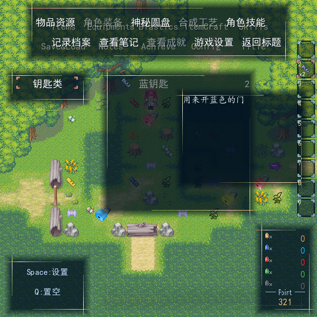

# 0.58 读档、BGM与共享物品栏验证

2026-10-19：修正已实现并通过针对性自查，等待用户验收。版本仍为0.58，当前工程为`../../output/0.58/load-release/黎之闪翼（开发中）_Godot/project.godot`。

- 读档显示动态“正在准备游戏资源／正在读取存档／正在进入游戏”提示。只读资源后台预载，完整存档校验在主线程分帧进行，校验成功才安装状态。地图内读档不再先恢复旧地图，事件现场只在新Game恢复一次。
- 已保存音乐和播放位置优先；旧档没有音乐记录时补播地图BGM/BGS。新增可选停止标记保留有意静音；不改用户音量设置。旧空记录无法区分历史有意停止，按地图自动音乐处理。
- 地图右侧和物品页预设为同一个HUD.item_canvas、同一帧纹理与光标，不再生成presets窗口。地图第9层保留Message遮挡，物品页临时提到第55层，关闭后回第9层。

| 本轮验证 | 结果 |
| --- | --- |
| 最终原RM全新迁移 | 报告成功、无导出错误；145原生入口、38份升级证据；维护运行/编辑器脚本与交付逐字节一致；339来源审计目标SHA一致 |
| 运行检查 | 先完成9组针对性回归；最终物品栏层级修正后重新通过5组：197脚本编译、27项读档/共用栏、24项援护预览、86项功能窗口、553项原生迁移 |
| 编辑器 | 最终导出编译51脚本和迁移审计15项通过 |
| 实际图形 | 32项检查、5画面；动态文字、BGM通道播放/未暂停、保存曲目/位置及有意静音、同一物品栏实例/纹理/八帧选择、层级恢复 |
| 真实确认和跨进程 | 地图读档2项、损坏主档转备份4项、回标题1项；保存/另进程读取3+6项通过 |
| 实际存档副本 | Map023旧档成功恢复“试炼区”BGM；8种动态文字、478帧，原文件SHA与副本及测试前一致；用户存档不打包 |
| 文档及兼容 | 1,614项接口检查，266生产脚本/1,640公开方法，452维护脚本中文接口头；原生定义指纹保持 |

最终GPU测试使用Compatibility/NVIDIA GTX1660Ti，测试进程Dummy音频并单独禁用VSync，正式配置不变。首次冷读约9.14秒、最大帧间隔740毫秒，497帧中记录7种动态文字；随后两次同进程读档分别572/470毫秒，最大帧间隔252/208毫秒。实际用户旧档副本另次冷读8.66秒、最大483毫秒。首次资源编译仍有等待和帧峰值，不能称为瞬间读档或全程稳定60帧；不同夹具及冷暖缓存测量不作同条件速度提升对比。音频检查确认真实播放器状态，不代表扬声器听音验收。

失败存档不会改变当前金币/地图/暂停状态，提交锁会释放；新测试也验证事件朝向在新地图恢复，防止旧地图提前消耗现场。畸形停止标记拒绝加载；代码取消或切换现场后不会安装旧结果。

实现及接口见[修正说明](../docs/LOAD_FIXES_v0.58.md)。此前完整0.58和UI修正记录保留历史测试事实，本轮只宣称本页及同名JSON列出的复验。新分辨率窗口位置与Flash前缀按原安排留待后续。无GDScript错误；本机根证书、无界面纹理诊断如实保留。早期临时存档诊断退出时有3个ObjectDB残留提示，其恢复断言通过，未把该诊断算作无警告测试。
