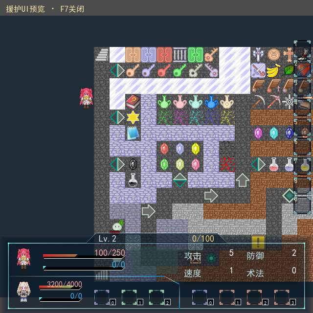
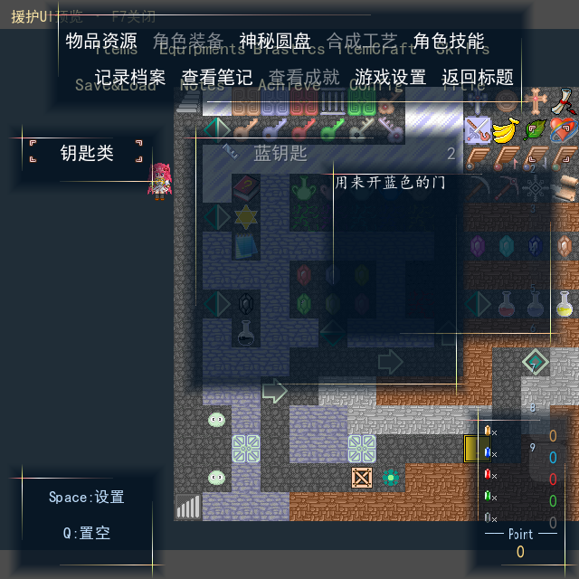
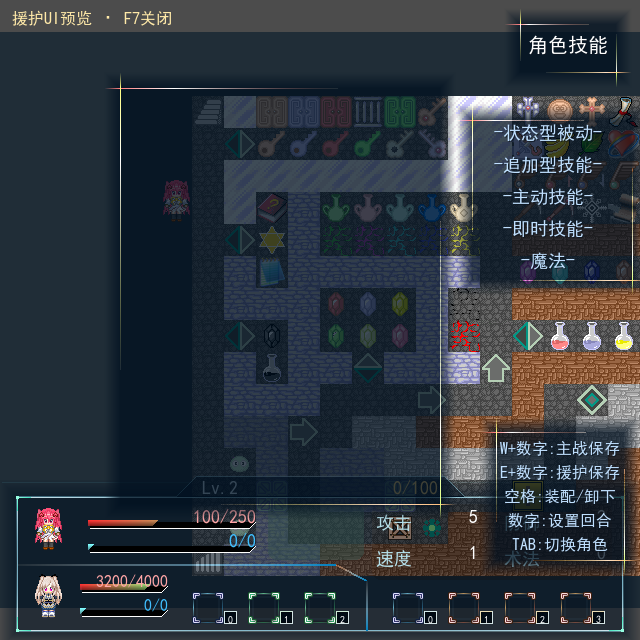

# 0.58 UI修正自查与验收

2026-10-19：当前交付已更新到`../../output/0.58/load-release/`，新增读档、BGM和共用物品栏验证见[本轮记录](VERIFICATION_v0.58_LOAD.md)。本页保留历史检查事实。

2026-10-19：两项用户反馈已实现并自查通过，等待人工验收。当前工程：`../../output/0.58/ui-review/黎之闪翼（开发中）_Godot/project.godot`。

- 物品页右侧1—9格快捷物品栏取消外层背景，保留格框、图标、数量、编号、选择光标和过渡；分类、物品列表及说明窗口保留。
- 在Godot调试运行中，进入地图后按F7显示援护，再按F7关闭；技能配置页可直接切换。使用原角色3的图像与预设，主战为3时使用角色2。已有正式援护仍显示真实数据。
- 开关默认关闭，重开、读档和回标题关闭；不改正式队伍、变量/解锁开关、背包、战斗或存档，不将预览角色作为物品目标或可操作的技能角色。原未完成BUFF区域留空。原事件验收地图保留F7退出。

| 本轮正式交付自查 | 结果 |
| --- | --- |
| 从原RM重新导出 | 报告ok=true、errors为空；339槽审计及所有目标SHA匹配；运行与编辑器代码逐文件一致 |
| 运行回归 | 8组通过：196运行脚本编译、24项新预览、19项物品页、功能窗口、菜单档案，以及表现、持久化、原生迁移定义检查；具体项数以同名JSON标记为准 |
| 编辑器 | 编译与迁移覆盖审计两组通过 |
| 实际图形与输入 | 29项检查、5画面通过；F7开关/长按/物理键、暂停菜单内切换、技能页、真实援护优先、主战3回退与原F7退出兼容 |
| 数据边界 | 启用与绘制预览前后完整SaveCodec.capture逐字段一致；未招募的预览角色不出现在正式actors中；实际execution_reset清除开关及私有角色 |
| 文档与兼容 | 1,608项接口检查、265生产脚本/1,632公开方法；450维护脚本中文接口头。145原生事件、38份升级证据完整，定义指纹沿用原0.58 |

此前0.58的60组完整回归、34个错误边界与65画面作为[历史自查](VERIFICATION_v0.58.md)保留；本轮只宣称上表和同名JSON列出的针对性复验。没有改窗口位置、原公式、战斗规则或保存格式。

实现及接口见[UI修正说明](../docs/UI_FIXES_v0.58.md)。GPU使用Compatibility/NVIDIA GTX1660Ti，测试进程单独禁用VSync，正式配置不变。根证书读取诊断是本机环境记录；本轮无GDScript错误。初次新增测试的autoload加载顺序及真实角色HP夹具已修正，未因此改动正式业务。
